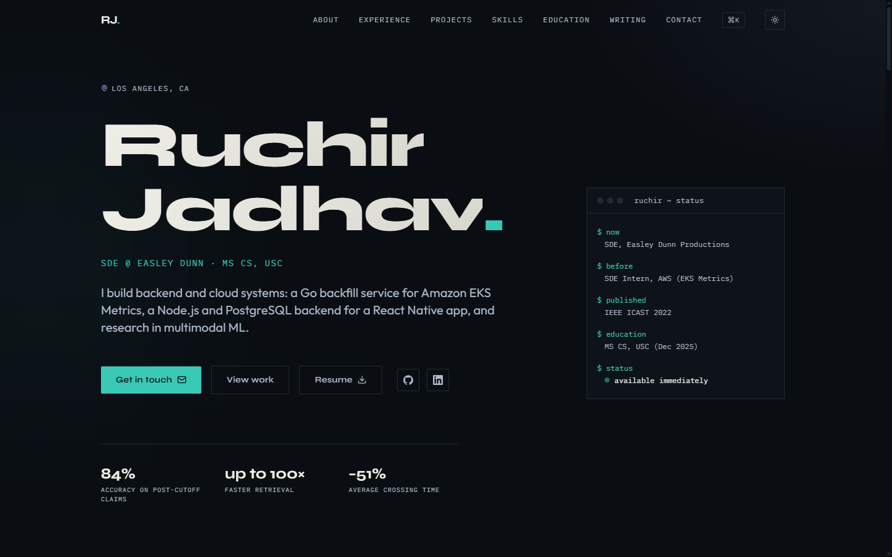
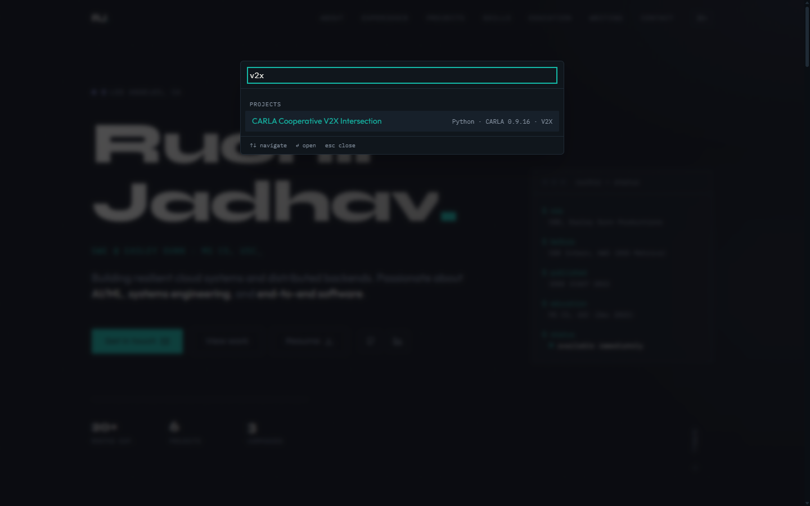

# ruchirjadhav.dev

My personal portfolio and writing site: a fully static Next.js app that shows my experience, projects and publication, with long-form case studies, a blog and a command palette. Live at **[ruchirjadhav.dev](https://ruchirjadhav.dev)**.



## What's in it

- **Case studies.** Every project and role has its own page with an architecture diagram, the key decisions with the reasoning and measured result, and the full write-up. Page transitions use React's `<ViewTransition>`, so a title glides from its card to the page.
- **⌘K command palette.** Press `⌘K` or `Ctrl+K` anywhere to jump to a section, project, post or link. It is a native `<dialog>`, so focus trapping and `Esc` come from the browser.
- **Writing.** MDX posts in `content/posts`, validated at build time with [Velite](https://velite.js.org/): a missing title or a malformed date fails the build instead of shipping. Posts get an RSS feed, structured data and their own share image.
- **Built to be found.** Per-page metadata and canonical URLs, JSON-LD (Person, BlogPosting, breadcrumbs, and the published paper as a ScholarlyArticle), a sitemap, generated Open Graph images for every project, role and post, and an `llms.txt`.
- **Light and dark themes.** Follows your system setting, remembers your choice, and never flashes the wrong theme on load. Colours come from one file and are checked in CI against both WCAG and APCA contrast.
- **Accessible by default.** Skip link, visible focus rings, semantic landmarks, and `prefers-reduced-motion`, `prefers-contrast` and forced-colours (Windows high contrast) respected.



## Stack

Next.js 16 (App Router, fully static) · React 19 · TypeScript · Tailwind CSS 3 · [motion](https://motion.dev/) · MDX via Velite · deployed on Vercel.

## Quality gates

Every push runs GitHub Actions: ESLint, `tsc`, a colour-contrast check for both themes and for high-contrast mode, a production build, a dependency-free smoke test of the built pages, and Lighthouse CI on every page in both themes. Accessibility and SEO must score at least 0.95 or the build fails; performance and best practices warn.

## Run it locally

```bash
npm install
npm run dev        # http://localhost:3000
npm run build      # static build, also runs Velite
npm run lint
```

After editing a post while the dev server is running, run `npx velite build` to refresh the content layer.

## How it's organised

| Path | What lives there |
| --- | --- |
| `data/resume.ts` | The single source of truth for content. Components only render it |
| `data/projectDetails.ts`, `experienceDetails.ts`, `caseStudies.ts` | The long-form case-study content |
| `content/posts/` | MDX posts with typed frontmatter (`velite.config.ts`) |
| `lib/colors.json`, `lib/palette.ts` | The one place colours are defined, for both themes; Tailwind, the stylesheet and the generated images use it |
| `components/` | Page sections and the command palette |
| `app/` | Routes: home, `projects/[slug]`, `experience/[slug]`, `writing`, feed, sitemap, share images |
| `scripts/smoke.mjs`, `scripts/contrast.mjs` | The smoke test and the colour-contrast gate CI runs |

## Related projects

- [carla-v2x-intersection](https://github.com/Ruchir317/carla-v2x-intersection): a traffic-light-free junction controller for the CARLA simulator.
- [claim-verifier](https://github.com/Ruchir317/claim-verifier): fact-checks a claim with web search and Gemini.
